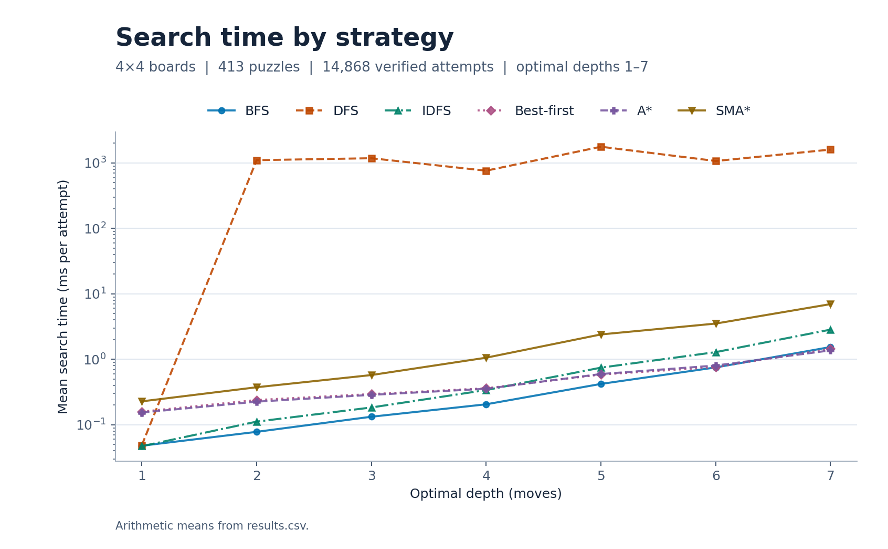
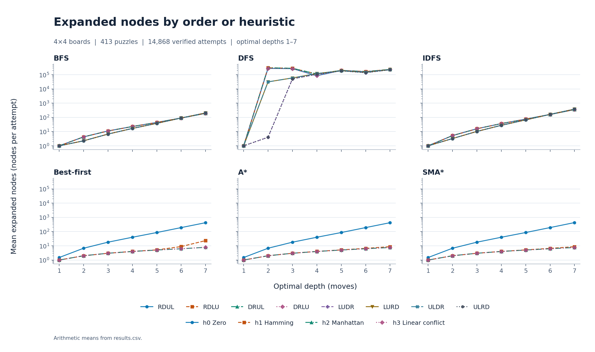

# Search strategies for the Fifteen Puzzle

## Introduction

This study compares six searches on 413 reachable 4×4 sliding puzzles whose
optimal solutions have one to seven moves. All 14,868 solver replies replayed
legally to the goal. BFS, IDFS, A* and SMA* matched the known optimal length
in every tested configuration. Search order changed the quality and cost of
DFS, while the heuristic changed how much work the informed searches did.

## Problem formalisation

A state is a row-major tuple of the tiles and the blank, represented by zero.
The goal is `1, 2, …, 15, 0`. A move swaps the blank with an orthogonal
neighbour at unit cost. As in the assignment, its letter names the direction
in which the tile slides into the blank: `L` moves the tile that has the
free space on its left, so the blank itself moves right.
A 4×4 board has two legal moves at a corner, three at a non-corner edge and
four in the interior. After the first move the solver omits the immediate
reverse move, leaving at most three successors before duplicate handling.

The board has `16!` permutations, partitioned into two equally sized
reachability classes. With the blank treated as tile 16, a board is in the
goal's class exactly when the parity of the full permutation's inversion
count equals the parity of the blank's Manhattan distance from its goal
cell. Each legal move flips both parities. The same test applies to
rectangles of at least two rows and two columns. On a single row or column,
tiles cannot pass each other, so their non-blank order must already match
the goal. The benchmark generator assigns exact distances by running BFS
backward from the goal. [Project contract](../CONTRACT.md#71-solvability)

## Algorithms and heuristics

| Strategy | Selection and duplicate handling | Path-length property |
|---|---|---|
| BFS | FIFO queue, with a global discovered-state set | Shortest path with unit move costs |
| DFS | Stack with a depth cap. A state can be revisited at a lower depth. | Returns the first goal reached within the limit |
| IDFS | DFS rerun at increasing depth limits, with a fresh depth map each time | Shortest path within the limit |
| Best-first | Priority `h`, with a discovered-state set | Greedy selection can return a longer path |
| A* | Priority `g + h`, with best known `g` per state and reopening on improvements | Shortest path with an admissible heuristic |
| SMA* | Priority `g + h` with backed-up bounds and a cap on stored nodes | Shortest path if the shallowest optimal path fits the cap |

Here `g` is the number of moves from the start. An admissible `h` is a
lower bound on the minimum number of remaining moves. A* uses this bound
to compare paths with different costs. Best-first uses it only to rank
boards by their estimate of the remaining distance. [AIMA, chapter 3](https://aima.cs.berkeley.edu/)

| ID | Heuristic | Why it is admissible |
|---|---|---|
| 0 | Zero | Zero is a lower bound on every remaining distance. |
| 1 | Hamming | Every misplaced non-blank tile has to move at least once. |
| 2 | Manhattan | Every non-blank tile must cover at least its row distance plus its column distance. Each move advances one tile by one grid step. |
| 3 | Linear conflict | For each goal row or column, count the minimum removals needed to order tiles already in that line. Each required removal forces a departure and return perpendicular to the line. Add twice the removal count to Manhattan. |

The implementation excludes the blank from every heuristic. Manhattan
distance dominates Hamming because every misplaced tile contributes at
least one grid step. Linear conflict adds a nonnegative correction to
Manhattan.

## Implementation

All searches use the shared board geometry, neighbour tables and parity
check. Parent pointers and move letters reconstruct the path. BFS, DFS and
IDFS test for the goal at generation. The three informed searches test on
selection and generate legal successors in `LRUD` letter order (tile
directions). Resident informed
frontiers use lower `f`, then lower `h`, then insertion order to break ties.
SMA* generates one successor at a time. At capacity it forgets the
highest-bound, shallowest eligible leaf and records the bound at its
parent. It can later replay the saved move and start the restored branch
with the recorded bound. At equal bounds it gives resident work priority
over replays and restores deeper forgotten alternatives first.
[Russell's SMA* paper](https://www.cse.sc.edu/~mgv/csce580f09/gradPres/Russell_ecai92-sma.pdf)

The runner starts a fresh solver process per attempt, sends the board
through stdin, captures stdout and reads a JSON statistics file. The
verifier replays every returned solution with the same move rules and
checks that it ends at the goal. A solution is optimal when the verified
`solution_length` equals the independent BFS label in `depth`.

## Experimental setup

The 413 boards are all states at optimal depths 1–7 from the 4×4 goal.
The seven layers contain 2, 4, 10, 24, 54, 107 and 212 boards. Each board
was run on all 36 configurations. BFS, DFS and IDFS each ran the eight
orders listed in the results table. Best-first, A* and SMA* each ran the
four heuristic IDs. The timeout was 60 seconds per subprocess. DFS and
IDFS used a depth limit of 20 and SMA* used a 100,000-node cap.

The single-machine run used an Intel Core i9-8950HK laptop, WSL 2 with Ubuntu
22.04.5 LTS, and CPython 3.10.12. WSL reported 12 logical CPUs and about
15 GiB of visible memory. The runner executed one
solver process at a time. The archived run record includes the timing
boundaries and validation. [Measurement record](../results/README.md)

Each figure point is the arithmetic mean of solved, verified attempts at
one optimal depth. Strategy comparisons pool all parameters of that
strategy at that depth. Parameter comparisons use one strategy and one
parameter at a time. Every board in a group receives equal weight in this
complete matrix. Overall table means pool attempts across depths, so the
larger depth-6 and depth-7 layers contribute more rows.

`time_ms` measures the search phase in milliseconds per attempt. Total
benchmark time also includes subprocess startup, parsing, the solvability
check, I/O, verification and the durable write. `visited_states` counts
generated nodes including duplicates, and `processed_states` counts
expanded nodes. IDFS sums these counters across iterations.
`max_depth_reached` records the deepest generated node. `peak_stored_states`
records the peak count of distinct tracked states, or resident nodes for
SMA*. These counts represent algorithmic storage. The benchmark did not
measure RAM in bytes.

## Results

All attempts finished as `solved` with `verified=true`. The mean search
times below use one attempt as the denominator, accounting for the
different numbers of configurations in the strategy groups.

| Strategy | Attempts | Length = depth | Mean length (moves) | Largest excess (moves) | Mean search (ms) |
|---|---:|---:|---:|---:|---:|
| BFS | 3,304 | 3,304 | 6.131 | 0 | 1.058 |
| DFS | 3,304 | 112 | 17.866 | 16 | 1,414.719 |
| IDFS | 3,304 | 3,304 | 6.131 | 0 | 1.917 |
| Best-first | 1,652 | 1,650 | 6.153 | 18 | 1.047 |
| A* | 1,652 | 1,652 | 6.131 | 0 | 1.021 |
| SMA* | 1,652 | 1,652 | 6.131 | 0 | 4.888 |

The search phase totalled 4,695.553 seconds across all rows. DFS accounted
for 4,674.233 seconds, about 99.5% of that total. The full benchmark took
1 hour 45 minutes 37 seconds. At depth 7, IDFS generated 797.7 nodes and retained
a peak of 354.6 states on average, while BFS generated 424.9 nodes and
retained a peak of 419.4. DFS reached a mean maximum depth of 19.910 at
the same optimal depth under the 20-move limit. The highest observed
SMA* storage count was 1,535 nodes.

### Fixed move orders

Every order produced 413 optimal BFS paths and 413 optimal IDFS paths.
The generated-node means show the effect of the orders on their work.
The DFS columns compare path quality and search time for each order.

| Order | BFS generated (mean) | IDFS generated (mean) | DFS optimal / 413 | DFS mean length (moves) | DFS mean search (ms) |
|---|---:|---:|---:|---:|---:|
| RDUL | 278.6 | 518.3 | 8 | 18.354 | 1,465.147 |
| RDLU | 278.6 | 518.4 | 7 | 18.339 | 1,506.477 |
| DRUL | 278.6 | 518.4 | 7 | 18.339 | 1,504.932 |
| DRLU | 278.6 | 518.3 | 8 | 18.354 | 1,440.792 |
| LUDR | 287.9 | 541.3 | 21 | 17.346 | 1,312.791 |
| LURD | 287.9 | 541.4 | 20 | 17.424 | 1,372.695 |
| ULDR | 287.9 | 541.4 | 20 | 17.424 | 1,397.580 |
| ULRD | 287.9 | 541.3 | 21 | 17.346 | 1,317.343 |

The first four orders, which try tile moves `R` and `D` first, generated
fewer nodes in BFS and IDFS on average. For DFS the pattern reverses: LUDR
and ULRD had the shortest mean solutions and the most optimal results, and
LUDR also had the lowest measured mean search time among the DFS orders.

### Heuristic comparisons

The table pools 413 attempts per strategy and heuristic. Both longer
Best-first paths occurred with Hamming. The longest was 25 moves for a
board whose optimal length was 7.

| Strategy | Heuristic | Optimal / 413 | Mean expanded nodes | Mean search (ms) |
|---|---|---:|---:|---:|
| Best-first | 0 Zero | 413 | 280.329 | 2.802 |
| Best-first | 1 Hamming | 411 | 15.230 | 0.287 |
| Best-first | 2 Manhattan | 413 | 6.630 | 0.299 |
| Best-first | 3 Linear conflict | 413 | 6.620 | 0.799 |
| A* | 0 Zero | 413 | 280.329 | 2.790 |
| A* | 1 Hamming | 413 | 7.172 | 0.194 |
| A* | 2 Manhattan | 413 | 6.508 | 0.301 |
| A* | 3 Linear conflict | 413 | 6.508 | 0.798 |
| SMA* | 0 Zero | 413 | 284.240 | 17.629 |
| SMA* | 1 Hamming | 413 | 7.172 | 0.484 |
| SMA* | 2 Manhattan | 413 | 6.508 | 0.529 |
| SMA* | 3 Linear conflict | 413 | 6.508 | 0.909 |

### Figure index

All figures use optimal depth in moves on the horizontal axis. They use
logarithmic vertical axes for state or node counts and search time, and
linear axes for lengths and depths. Zeros contribute to the arithmetic
mean. When a complete group mean is zero on a log axis, a hollow triangle
below the smallest positive mean marks its position. The archived CSV
produced no zero means on these axes.

| Metric | Strategy comparison | Order or heuristic comparison |
|---|---|---|
| Solution length | [PNG](figures/solution_length_strategies.png) · [PDF](figures/solution_length_strategies.pdf) | [PNG](figures/solution_length_parameters.png) · [PDF](figures/solution_length_parameters.pdf) |
| Generated nodes | [PNG](figures/visited_states_strategies.png) · [PDF](figures/visited_states_strategies.pdf) | [PNG](figures/visited_states_parameters.png) · [PDF](figures/visited_states_parameters.pdf) |
| Expanded nodes | [PNG](figures/processed_states_strategies.png) · [PDF](figures/processed_states_strategies.pdf) | [PNG](figures/processed_states_parameters.png) · [PDF](figures/processed_states_parameters.pdf) |
| Maximum search depth | [PNG](figures/max_depth_reached_strategies.png) · [PDF](figures/max_depth_reached_strategies.pdf) | [PNG](figures/max_depth_reached_parameters.png) · [PDF](figures/max_depth_reached_parameters.pdf) |
| Peak storage | [PNG](figures/peak_stored_states_strategies.png) · [PDF](figures/peak_stored_states_strategies.pdf) | [PNG](figures/peak_stored_states_parameters.png) · [PDF](figures/peak_stored_states_parameters.pdf) |
| Search time | [PNG](figures/time_ms_strategies.png) · [PDF](figures/time_ms_strategies.pdf) | [PNG](figures/time_ms_parameters.png) · [PDF](figures/time_ms_parameters.pdf) |

## Discussion

The IDFS measurements show the trade-off between regenerating nodes at
successive limits and retaining states during one breadth-first search.
The DFS implementation keeps a depth map, and its measured storage
therefore includes substantially more than the current path. Its longer
legal solutions and higher search cost are associated with exploring
almost to the depth cap on many shallow puzzles.

At optimal depth 7, A* with zero expanded 422.274 nodes on average,
compared with 8.665 for Hamming and 7.613 for both Manhattan and linear
conflict. SMA* showed the same means for the three nonzero heuristics.
Linear conflict required more search time than Manhattan in all three
informed strategies on these boards. The extra conflict computation
coincided with little or no reduction in expanded nodes. The timing
does not isolate the cost of heuristic evaluation, and the small
absolute differences between sub-millisecond means are machine-specific.

The 100,000-node cap was far above SMA*'s observed peak of 1,535.
This experiment measures the implementation under that limit and cannot
estimate the cost of eviction and restoration under tighter memory.
The dataset covers shallow positions only. It supplies neither a
random sample of the reachable state space nor measurements for depths
beyond seven.

## Conclusions

On the complete depth-1–7 set, BFS, IDFS, A* and SMA* all matched the
shortest-path labels under the tested limits. A* with Hamming gave the
lowest measured mean search time among the tested A* heuristics, while
Manhattan and linear conflict expanded fewer nodes. DFS performance
depended markedly on the tested order and depth cap, and greedy
Best-first with Hamming produced two legal paths longer than optimal.
These results characterise the recorded dataset and configuration.

## References

- Russell, S. J., and Norvig, P. *Artificial Intelligence: A Modern Approach*,
  4th US edition, chapter 3. [Official book site](https://aima.cs.berkeley.edu/)
- Russell, S. J. (1992). *Efficient Memory-Bounded Search Methods*. Proceedings
  of ECAI 1992. [Paper](https://www.cse.sc.edu/~mgv/csce580f09/gradPres/Russell_ecai92-sma.pdf)
- Fifteen Puzzle. [Project contract](../CONTRACT.md) · [M7 CSV](../results/results.csv) ·
  [Experiment metadata](../results/results.csv.meta.json) · [Measurement record](../results/README.md)
